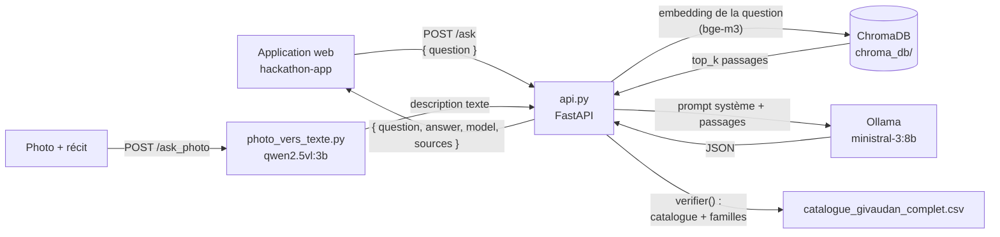

````markdown
# rag-g24 · Moteur IA de Givaudan Scent Journey

Service **Data/IA** du projet *Givaudan Scent Journey* (Givaudan AI Innovation Challenge 2026, HETIC).

Le client raconte un souvenir (texte, ou photo + récit). Ce service retrouve dans une base de connaissances les passages pertinents (odeurs, émotions, lieux, ingrédients Givaudan), puis demande à un LLM local d'en tirer une **analyse olfactive structurée** :

- une **compréhension** du souvenir (lieu, moment, météo, émotion, éléments) ;
- une **signature** olfactive (nom + description) ;
- une **roue** des familles olfactives (pourcentages qui totalisent 100) ;
- un **profil** tête / cœur / fond, uniquement avec des ingrédients du **catalogue Givaudan** ;
- les **limites** du catalogue, les **informations manquantes** et un **brief** pour le parfumeur.

Tout tourne **en local** avec [Ollama](https://ollama.com) : aucune donnée ne quitte la machine, sauf si on ouvre un tunnel ngrok (voir [Exposer le service](#exposer-le-service-avec-ngrok)).

L'application web de l'équipe ([6OnTheBeach/hackathon-app](https://github.com/6OnTheBeach/hackathon-app)) appelle ce service sur `POST /ask`.

---

## Sommaire

1. [Architecture](#architecture)
2. [Contenu du dépôt](#contenu-du-dépôt)
3. [Prérequis](#prérequis)
4. [Installation](#installation-une-seule-fois)
5. [Lancer le service](#lancer-le-service)
6. [L'API](#lapi)
7. [Exposer le service avec ngrok](#exposer-le-service-avec-ngrok)
8. [Brancher l'application web](#brancher-lapplication-web-hackathon-app)
9. [Configuration](#configuration)
10. [Scripts utilitaires](#scripts-utilitaires)
11. [Choix des modèles](#choix-des-modèles)
12. [Dépannage](#dépannage)
13. [Limites connues et pistes](#limites-connues-et-pistes)

---

## Architecture



Le déroulé d'un appel à `/ask` :

1. **Recherche (retrieval).** La question est transformée en vecteur par `bge-m3`. ChromaDB renvoie les `top_k` morceaux de `base_scent_journey.txt` les plus proches, avec la similarité cosinus.
2. **Génération.** Les passages sont envoyés à `ministral-3:8b` avec un prompt système qui impose le format JSON et interdit d'inventer des ingrédients ou des sources. Le mode `format="json"` d'Ollama et une température de 0,2 rendent la sortie plus stable.
3. **Vérification.** `verifier()` relit la réponse :
   - tout ingrédient dont la `reference` n'est pas dans le catalogue est **retiré du profil** et signalé dans `limites_catalogue` ;
   - le nom officiel du catalogue remplace le nom proposé par le modèle ;
   - les familles de la roue qui ne font pas partie des 13 familles officielles sont supprimées, puis les pourcentages sont **renormalisés à 100**.
4. **Réponse.** Le service renvoie l'analyse, le modèle utilisé et les passages sources.

---

## Contenu du dépôt

| Fichier | Rôle |
|---|---|
| `api.py` | Le service FastAPI : routes `/health`, `/search`, `/ask`, `/ask_photo`, prompt système, vérification par le catalogue |
| `rag.py` | Les briques communes : client Ollama, collection ChromaDB, embeddings, appel au LLM |
| `config.py` | La configuration, surchargeable par variables d'environnement |
| `ingest.py` | Découpe `base_scent_journey.txt` en morceaux et les indexe dans ChromaDB |
| `list.py` | Affiche le contenu de la base vectorielle |
| `clean.py` | Vide la base vectorielle |
| `photo_vers_texte.py` | Décrit une photo avec un modèle de vision, puis construit la question envoyée au RAG |
| `bench.py` | Compare plusieurs LLM Ollama sur les mêmes questions (temps, vitesse, justesse) |
| `base_scent_journey.txt` | La base de connaissances : 63 chapitres (science de l'olfaction, émotions, lieux, souvenirs, industrie, catalogue Givaudan par famille), sources S001 à S294 |
| `catalogue_givaudan_complet.csv` | Le catalogue des **157 ingrédients** Givaudan (séparateur `;`) : référence, nom, famille, notes olfactives, performances, durabilité… |
| `benchmark_llm.pdf` | Le rapport de benchmark qui justifie le choix des modèles |
| `requirements.txt` | Les dépendances Python |

Le dossier `chroma_db/` (la base vectorielle) est **généré** par `ingest.py` et ignoré par git. Chacun le reconstruit sur sa machine.

---

## Prérequis

| Outil | Version | Pour quoi |
|---|---|---|
| Python | 3.10 ou plus | Le service (syntaxe `dict \| str`) |
| [Ollama](https://ollama.com/download) | récente | Faire tourner les modèles en local |
| RAM | 16 Go conseillés | `ministral-3:8b` occupe environ 10 Go. Sur 8 Go, utiliser `ministral-3:3b` (voir [Configuration](#configuration)) |
| Disque | ~8 Go | Les modèles Ollama |
| [ngrok](https://ngrok.com/download) | 3.x | Seulement pour exposer le service à l'équipe |

Sur Mac, Ollama utilise le GPU Apple Silicon : c'est la configuration testée.

---

## Installation (une seule fois)

Toutes les commandes se lancent dans un terminal, **à la racine du dépôt**.

### 1. Ollama et les modèles

```bash
# macOS : l'application sur ollama.com/download, ou
brew install ollama && brew services start ollama

ollama pull ministral-3:8b   # LLM : rédige l'analyse (~6 Go)
ollama pull bge-m3           # embeddings : recherche des passages (~1,2 Go)
ollama pull qwen2.5vl:3b     # vision : seulement pour /ask_photo
```

Pour vérifier que les modèles sont installés : `ollama list`.

### 2. L'environnement Python

```bash
python3 -m venv .venv
source .venv/bin/activate        # Windows : .venv\Scripts\activate
pip install -r requirements.txt
```

### 3. La base vectorielle

```bash
python ingest.py
```

Résultat attendu :

```
Histoire : Givaudan Scent Journey – Base de connaissances : …
63 chapitres, N morceaux à indexer
Calcul des embeddings avec 'bge-m3'...
OK : N morceaux dans la collection 'story' (…/chroma_db)
```

Sans cette étape, `/ask` répond **503 « La base est vide »**.

Relance `ingest.py` à chaque modification de `base_scent_journey.txt`. Si tu as supprimé ou renommé des chapitres, lance d'abord `python clean.py`, pour ne pas garder d'anciens morceaux.

---

## Lancer le service

```bash
source .venv/bin/activate
uvicorn api:app --port 8000
```

| Adresse | Contenu |
|---|---|
| http://localhost:8000/docs | Swagger : la documentation interactive, pour tester chaque route |
| http://localhost:8000/health | L'état de la base et les modèles utilisés |

Options utiles :

- `--reload` : redémarre le service à chaque modification du code, pratique en développement ;
- `--host 0.0.0.0` : rend le service joignable depuis un conteneur Docker ou le réseau local. C'est nécessaire si l'application web tourne en dev container sur **la même machine** (`DATA_AI_URL=http://host.docker.internal:8000`). Avec ngrok, ce n'est pas utile.

> Une analyse prend **20 secondes ou plus** : c'est normal, le LLM génère un JSON complet. Le premier appel est plus lent, le temps que le modèle se charge en mémoire.

---

## L'API

### `GET /health`

Vérifie que la base est chargée.

```json
{ "chunks": 412, "llm_model": "ministral-3:8b", "embed_model": "bge-m3" }
```

`chunks` doit être **supérieur à 0**.

### `POST /search`

Renvoie seulement les passages retrouvés, **sans appeler le LLM**. C'est utile pour vérifier la qualité de la recherche.

```bash
curl -X POST localhost:8000/search \
  -H 'Content-Type: application/json' \
  -d '{"question": "odeur de pluie sur la terre", "top_k": 4}'
```

```json
[
  { "chapter": "Chapitre 7 : Lieux et nature : pluie", "text": "…", "score": 0.7123 }
]
```

### `POST /ask`

**La route principale**, celle qu'appelle l'application web.

Corps de la requête :

| Champ | Type | Obligatoire | Description |
|---|---|---|---|
| `question` | string | oui | Le récit du client (au moins 1 caractère) |
| `top_k` | int | non | Nombre de passages retrouvés, de 1 à 20, 4 par défaut |

```bash
curl -X POST localhost:8000/ask \
  -H 'Content-Type: application/json' \
  -d '{"question": "Un matin d'\''été en Thaïlande, après la pluie, je me sentais apaisée près d'\''un temple."}'
```

Réponse :

```json
{
  "question": "Un matin d'été en Thaïlande…",
  "answer": {
    "comprehension": {
      "lieu": "Thaïlande, temple",
      "moment": "matin d'été",
      "meteo": "après la pluie",
      "emotion": "apaisement",
      "elements": ["temple", "pluie", "végétation"]
    },
    "signature": { "nom": "…", "description": "…" },
    "roue": [
      { "famille": "Green", "pourcentage": 40 },
      { "famille": "Woody", "pourcentage": 35 },
      { "famille": "Floral", "pourcentage": 25 }
    ],
    "profil": {
      "tete":  [{ "ingredient": "…", "reference": "…", "raison": "…", "sources": ["S0xx"] }],
      "coeur": [ … ],
      "fond":  [ … ]
    },
    "limites_catalogue": [],
    "informations_manquantes": [],
    "brief": "…"
  },
  "model": "ministral-3:8b",
  "sources": [
    { "chapter": "Chapitre 10 : Lieux : Thaïlande", "text": "…", "score": 0.68 }
  ]
}
```

Les règles garanties par `verifier()` :

- chaque `reference` du profil existe dans `catalogue_givaudan_complet.csv`, et `ingredient` porte le nom officiel ;
- `roue` ne contient que ces 13 familles : Floral, Fruity, Citrus, Herbal - Agrestic, Woody, Green, Ambery, Spicy, Musky, Leather - Moss, Gourmand, Aldehydic, Marine. Le total vaut 100, à l'arrondi près.

Si le modèle ne renvoie pas un JSON valide, `answer` est une **chaîne de caractères** (le texte brut). L'application web le détecte et affiche « réessayez ».

Codes d'erreur :

| Code | Cause |
|---|---|
| 422 | Corps invalide (`question` vide ou absente, `top_k` hors de 1 à 20) |
| 502 | Ollama injoignable ou modèle absent (`Erreur Ollama : …`) |
| 503 | Base vide : lancer `python ingest.py` |

### `POST /ask_photo`

Analyse une photo de souvenir, puis enchaîne sur `/ask`. La requête est en `multipart/form-data` :

| Champ | Type | Description |
|---|---|---|
| `photo` | fichier | L'image (JPEG, PNG ; HEIC via `pillow-heif`) |
| `recit` | texte | Optionnel : ce que le client raconte de ce moment |

```bash
curl -X POST localhost:8000/ask_photo \
  -F 'photo=@souvenir.jpg' \
  -F 'recit=J'\''étais triste ce jour-là'
```

```json
{
  "description_photo": {
    "lieu": "plage", "pays_ou_culture_visible": "inconnu", "moment": "soir",
    "meteo": "soleil", "elements_visibles": ["mer", "sable"],
    "ambiance": "mélancolique", "odeurs_probables": ["iode", "sel"]
  },
  "resultat": { "question": "…", "answer": { … }, "model": "…", "sources": [ … ] }
}
```

---

## Exposer le service avec ngrok

L'application web tourne sur les machines des tech-leads. Pour qu'elle joigne ce service, qui tourne sur la machine Data/IA, on ouvre un **tunnel ngrok**.

### Première fois

1. Crée un compte gratuit sur https://dashboard.ngrok.com/signup.
2. Installe ngrok : `brew install ngrok`. Sans Homebrew, télécharge le `.zip` sur https://ngrok.com/download, décompresse-le et lance `./ngrok` depuis son dossier.
3. Enregistre ton jeton, à copier depuis https://dashboard.ngrok.com/get-started/your-authtoken :
   ```bash
   ngrok config add-authtoken TON_JETON
   ```

### À chaque session

Il faut **deux terminaux ouverts en même temps** :

```bash
# Terminal 1 : le service
source .venv/bin/activate
uvicorn api:app --port 8000

# Terminal 2 : le tunnel
ngrok http 8000
```

ngrok affiche `Session Status: online` et une ligne `Forwarding https://<nom>.ngrok-free.dev -> http://localhost:8000`. L'URL est rattachée au compte : **elle reste la même à chaque relance**.

Pour vérifier, ouvre `https://<nom>.ngrok-free.dev/health`. Au premier passage dans un navigateur, ngrok affiche une page d'avertissement : clique sur **Visit Site**. La racine `/` renvoie `{"detail":"Not Found"}`, c'est normal : il n'y a pas de route à cet endroit.

Transmets l'URL de base, **sans** `/health` ni `/ask`, aux tech-leads **en message privé**.

### Pour que le tunnel tienne

- Garde le Mac **sur secteur**, **sans mise en veille**, et ne ferme pas les deux terminaux.
- Si ngrok s'arrête, l'URL répond `ERR_NGROK_3200 … is offline` : relance `ngrok http 8000`.
- Le **Wi-Fi de l'école bloque ngrok** (`ERR_NGROK_8008 : No tunnel servers could establish a TLS connection`). Passe par le **partage de connexion** de ton téléphone, y compris le jour de la démo.
- Le plan gratuit offre **20 000 requêtes par mois** pour toute l'équipe. Pas de tests automatiques en boucle à travers le tunnel.

> ⚠️ **Le service n'a pas de clé d'API.** Toute personne qui connaît l'URL ngrok peut utiliser le modèle et ta machine. Ne publie pas l'URL dans un canal public, et coupe le tunnel quand personne n'en a besoin.

---

## Brancher l'application web (hackathon-app)

Dans le dépôt [hackathon-app](https://github.com/6OnTheBeach/hackathon-app), l'API choisit son fournisseur d'IA avec `AI_PROVIDER` :

| `AI_PROVIDER` | Comportement |
|---|---|
| `mock` (par défaut) | réponse fixe, sans ce service |
| `data` | appelle `POST {DATA_AI_URL}/ask`, délai maximum de 120 s |

**Avec le tunnel ngrok** (machines différentes), dans `api/.env` de hackathon-app :

```
AI_PROVIDER=data
DATA_AI_URL=https://<nom>.ngrok-free.dev
```

**Sur la même machine** (service lancé avec `--host 0.0.0.0`) :

```
AI_PROVIDER=data
DATA_AI_URL=http://host.docker.internal:8000
```

Puis relancer `npm run dev`.

Le contrat que l'application attend, à ne pas casser sans prévenir :

- la route `POST /ask`, avec le corps `{ "question": "…" }` ;
- la réponse `{ question, answer, model, sources }`, où `answer` est un **objet** avec les clés `comprehension`, `signature`, `roue`, `limites_catalogue`, `informations_manquantes`, `brief` et, de façon facultative, `profil`. Les types sont dans `api/src/modules/ai/ai.types.ts` côté hackathon-app.

Tout changement de route ou de format s'annonce à l'équipe, ou passe par une nouvelle route (par exemple `/v2/ask`).

---

## Configuration

Toutes les valeurs de `config.py` peuvent être surchargées par une variable d'environnement, par exemple :

```bash
LLM_MODEL=ministral-3:3b TOP_K=6 uvicorn api:app --port 8000
```

| Variable | Défaut | Rôle |
|---|---|---|
| `OLLAMA_HOST` | `http://localhost:11434` | Adresse d'Ollama |
| `LLM_MODEL` | `ministral-3:8b` | Modèle qui rédige l'analyse. `ministral-3:3b` sur un Mac de 8 Go |
| `EMBED_MODEL` | `bge-m3` | Modèle d'embeddings. **Le changer impose de relancer `clean.py` puis `ingest.py`** |
| `VISION_MODEL` | `qwen2.5vl:3b` | Modèle de vision (voir les [limites](#limites-connues-et-pistes)) |
| `CHROMA_DIR` | `./chroma_db` | Dossier de la base vectorielle |
| `COLLECTION_NAME` | `story` | Nom de la collection ChromaDB |
| `STORY_PATH` | `./base_scent_journey.txt` | Fichier indexé par `ingest.py` |
| `CHUNK_SIZE` | `800` | Taille cible d'un morceau, en caractères |
| `CHUNK_OVERLAP_PARAGRAPHS` | `1` | Paragraphes répétés d'un morceau à l'autre, pour garder le contexte |
| `TOP_K` | `4` | Nombre de passages envoyés au LLM par défaut |

### Format de `base_scent_journey.txt`

`ingest.py` découpe le fichier ainsi :

- les paragraphes sont séparés par une **ligne vide** ;
- le premier paragraphe, s'il n'est pas un chapitre, devient le **titre** de la base ;
- un **titre de chapitre** est un paragraphe de moins de 120 caractères qui commence par `Chapitre N : …` ou par un chiffre romain (`IV. …`) ;
- chaque chapitre est découpé en morceaux d'environ `CHUNK_SIZE` caractères. Le titre du chapitre est ajouté au texte avant le calcul de l'embedding, ce qui améliore la recherche.

Pour ajouter des connaissances, ajoute un chapitre en respectant ce format, cite ses sources (`S295`, …), puis relance `python ingest.py`.

---

## Scripts utilitaires

Tous se lancent avec le venv activé, à la racine du dépôt.

| Commande | Effet |
|---|---|
| `python ingest.py` | Indexe `base_scent_journey.txt` (ou `python ingest.py autre_fichier.txt`) |
| `python list.py` | Liste les morceaux indexés, regroupés par chapitre |
| `python list.py --full` | Idem, avec le texte complet de chaque morceau |
| `python clean.py` | Supprime la collection, avant une réindexation complète |
| `python photo_vers_texte.py photo.jpg "récit"` | Décrit la photo puis appelle `/ask`. Le service doit tourner sur `127.0.0.1:8000` |
| `python bench.py` | Compare les modèles listés dans `MODELS` |
| `python bench.py ministral-3:3b ministral-3:8b` | Compare seulement ces modèles |

`bench.py` lit `questions_test.csv`, avec les colonnes `question`, `type`, `reponse_attendue` et `mot_cle`, et écrit `resultats_benchmark.csv`. Ce fichier s'ouvre dans Excel, avec deux colonnes à remplir à la main : `correct` et `invente`.

---

## Choix des modèles

Le détail est dans `benchmark_llm.pdf`.

| Modèle | Bonnes réponses | Temps moyen | RAM | Usage |
|---|---|---|---|---|
| **ministral-3:8b** | 8 / 9 | 3,1 à 4,7 s | ~10 Go | **Retenu** : meilleur français, plus fidèle aux documents |
| ministral-3:3b | 6 / 9 | 2,7 s | ~6 Go | Solution de repli pour les Mac de 8 Go |

Ces temps ont été mesurés sur des réponses courtes. Une analyse Scent Journey complète, en JSON, prend nettement plus longtemps (20 s et plus).

**Embeddings : `bge-m3`**, à la place de `nomic-embed-text`. Il est multilingue (plus de 100 langues) : une question en français retrouve aussi les passages en anglais, comme les descriptions du catalogue. Il accepte des textes longs et tourne en local.

---

## Dépannage

| Symptôme | Cause et solution |
|---|---|
| `503 La base est vide` | Lancer `python ingest.py` |
| `502 Erreur Ollama : … not found` | Modèle absent : `ollama pull ministral-3:8b` (et `bge-m3`) |
| `502 Erreur Ollama : … connection refused` | Ollama n'est pas lancé : ouvrir l'application, ou `brew services start ollama` |
| `answer` est une chaîne, pas un objet | Le modèle a renvoyé un JSON invalide : réessayer. Si c'est fréquent, baisser `TOP_K` ou revoir le prompt |
| Réponses très lentes ou Mac qui rame | RAM insuffisante : `LLM_MODEL=ministral-3:3b` |
| Résultats incohérents après un changement de `EMBED_MODEL` | Base indexée avec l'ancien modèle : `python clean.py && python ingest.py` |
| `zsh: command not found: ngrok` | ngrok non installé, ou lancé hors de son dossier : `cd ~/Downloads && ./ngrok …` |
| `ERR_NGROK_105 … does not look like a proper ngrok authtoken` | Jeton mal copié : le recopier avec le bouton **Copy** du tableau de bord ngrok |
| `ERR_NGROK_8008` / `reconnecting (failed to send authentication request)` | Réseau qui bloque ngrok (Wi-Fi de l'école) : partage de connexion, ou couper le VPN |
| `ERR_NGROK_3200 … is offline` | Le terminal ngrok a été fermé : relancer `ngrok http 8000` |
| `ERR_NGROK_3004` / `502 Bad Gateway` via ngrok | uvicorn est arrêté ou a planté : regarder son terminal, puis le relancer |
| `{"detail":"Not Found"}` sur l'URL ngrok | Normal à la racine : ajouter `/health` ou `/docs` |
| L'application web affiche « Le service d'IA est injoignable » | Service ou tunnel arrêté, ou `DATA_AI_URL` erroné dans `api/.env` de hackathon-app |

---

## Limites connues et pistes

- **Pas d'authentification.** Une fois exposé par ngrok, le service est public. Piste : un en-tête `X-API-Key` vérifié dans `api.py`, et envoyé par `ai.data.ts` côté hackathon-app. À coordonner avec les tech-leads.
- **Une seule machine.** Si le Mac Data/IA est éteint, en veille ou hors ligne, l'IA tombe pour toute l'équipe. L'application garde `AI_PROVIDER=mock` comme plan B.
- **Fichiers absents du dépôt :**
  - `questions_test.csv`, nécessaire à `bench.py` ; ses questions portent sur l'ancienne histoire de démonstration (`story.txt`) ;
  - `sources_scent_journey.csv`, auquel renvoient les identifiants S001 à S294 de la base.
- **`photo_vers_texte.py`** fixe `VISION_MODEL` en dur et utilise le client Ollama par défaut. Il ignore donc `VISION_MODEL` et `OLLAMA_HOST` de `config.py`. Piste : importer `config` et utiliser `rag._ollama`.
- **`/ask_photo`** garde la photo dans un fichier temporaire non supprimé, et appelle `ask()`, qui est synchrone, depuis une route `async`. Pendant l'analyse, le service ne traite pas d'autre requête.
- **Traces de l'ancien exemple.** Certains textes parlent encore d'« histoire » : le titre et la description du Swagger, la collection `story`, les docstrings d'`ingest.py`. Ça n'a pas d'effet sur le fonctionnement.
- **Les ingrédients proposés sont des pistes.** Le profil est construit à partir des notes olfactives du catalogue et de la base. Il doit être **validé par un parfumeur Givaudan** : les sources scientifiques ne citent pas ces ingrédients.

---

## Équipe

Équipe Data/IA du groupe 24 · HETIC, Master Tech-Lead/CTO · Givaudan AI Innovation Challenge 2026.
````