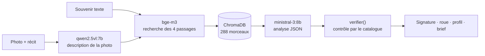
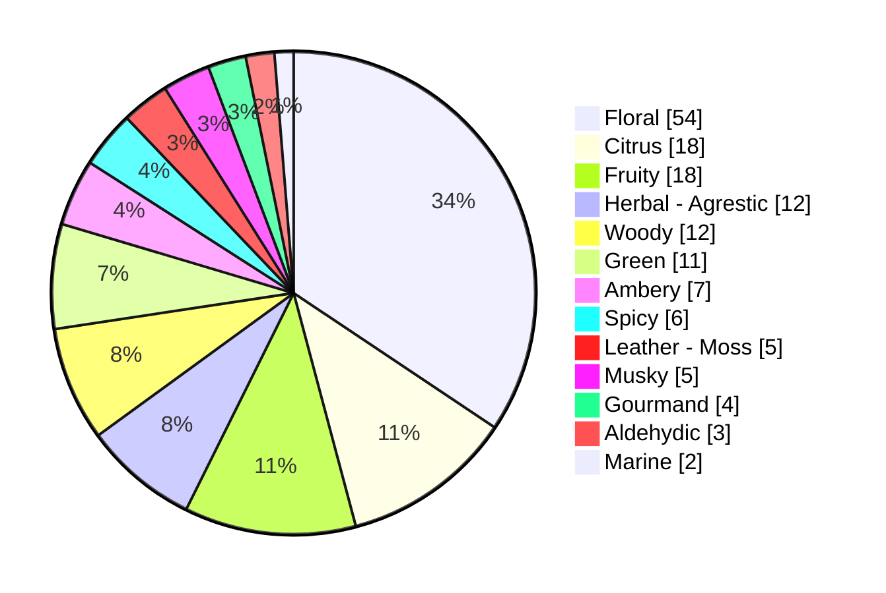
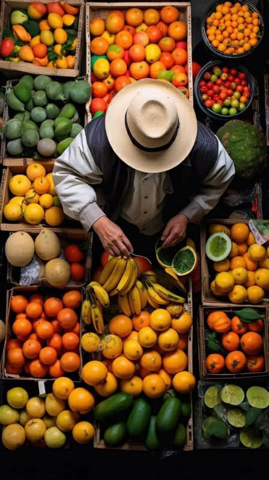
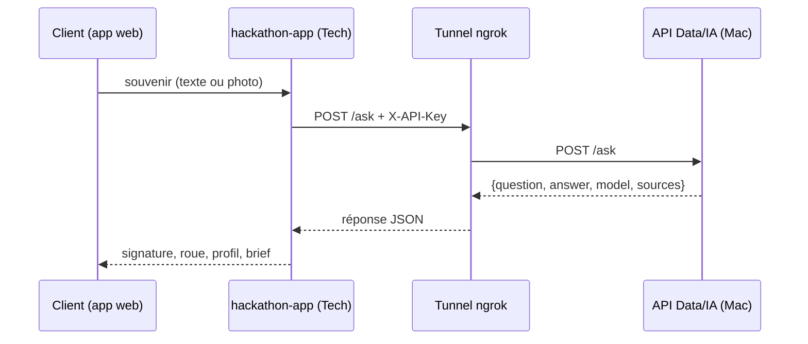

# Livrable Data/IA · groupe G24

Givaudan AI Innovation Challenge 2026 · **Givaudan Scent Journey** : du souvenir au profil olfactif.
Document de synthèse de la brique Data/IA. Chaque chiffre renvoie à un fichier du dépôt.


**Sommaire.** [0. Présentation](#0-présentation) · [1. Données](#1-données) · [2. Pipeline](#2-pipeline) · [3. Modèle](#3-modèle) · [4. Métriques](#4-métriques--évaluation-sur-les-7-dimensions) · [5. API](#5-api) · [6. Intégration Tech](#6-intégration-tech) · [7. Comparaison V1 / V2](#7-comparaison-v1--v2) · [8. Limites](#8-limites) · [9. Biais](#9-biais) · [10. Reproduire les résultats](#10-reproduire-les-résultats) · [11. Récapitulatif](#11-tableau-récapitulatif-des-livrables)



## 0. Présentation

**Le prototype.** Un client raconte un souvenir, en texte (« J'étais en Thaïlande après la pluie, j'étais triste ») ou avec une photo. Le moteur :

1. comprend le souvenir : lieu, moment, météo, émotion, éléments présents ;
2. retrouve dans une base de connaissances scientifique les passages qui relient ces éléments à des odeurs ;
3. propose une **signature olfactive** (nom et description) ;
4. construit une **roue des familles olfactives** (pourcentages qui totalisent 100) ;
5. compose un **profil tête / cœur / fond**, uniquement avec des ingrédients du catalogue Givaudan, chacun justifié par des sources ;
6. rédige un **brief** pour le parfumeur, avec les limites du catalogue et les informations manquantes.


**Vocabulaire.** Chaque terme a un seul sens dans ce document.

| Terme | Sens |
|---|---|
| Souvenir | Le texte du client (route `/ask`), ou une photo avec un récit facultatif (route `/ask_photo`). |
| Base de connaissances | [base_scent_journey.txt](base_scent_journey.txt) : 63 chapitres sur les liens entre odeurs, émotions, lieux et souvenirs. |
| Morceau | Un extrait de la base, d'environ 800 caractères, indexé dans ChromaDB. |
| Catalogue | [catalogue_givaudan_complet.csv](catalogue_givaudan_complet.csv) : 157 ingrédients Givaudan (molécules et spécialités), pas des parfums finis. |
| Famille | L'une des 13 familles olfactives du catalogue (colonne `famille_olfactive`) : Floral, Fruity, Citrus, Herbal - Agrestic, Woody, Green, Ambery, Spicy, Musky, Leather - Moss, Gourmand, Aldehydic, Marine. |
| Source | Un identifiant `S001` à `S294` qui renvoie à une publication citée dans la base. |
| Analyse | L'objet JSON renvoyé dans le champ `answer` (section 5). |
| Ingrédient inventé | Un ingrédient proposé par le LLM dont la référence n'existe pas dans le catalogue. Il est retiré par `verifier()`. |

**Équipe Data/IA.**

| Membre | Travail visible dans l'historique Git |
|---|---|
| Quentin Danel | Propriétaire du dépôt. Benchmark des LLM ([bench.py](bench.py), [benchmark_llm.pdf](benchmark_llm.pdf)), prompt système, choix des modèles (LLM, vision), base de connaissances, format court de la compréhension (commit `4572fa5`). |
| Emma Auspitz | Analyse de photo (route `/ask_photo`, [photo_vers_texte.py](photo_vers_texte.py)), réponse JSON du LLM, clé d'API, évaluation sur les 7 dimensions ([eval_2.py](evaluation_LLM/ask_photo/eval_2.py), [cas_test_2.json](evaluation_LLM/ask_photo/cas_test_2.json), [evaluation_LLM/](evaluation_LLM/)), tunnel ngrok, documentation. |

Le premier commit (`9b13d30`) est le modèle de RAG fourni par le cours (FastAPI + ChromaDB + Ollama), que l'équipe a adapté.

**Date.** 13/11/2026 (rendu final).

**Version.** Branche `main` du dépôt [FiveOnTheBeach/rag-g24](https://github.com/FiveOnTheBeach/rag-g24). Dernier commit au moment de la rédaction : `1c0681e` (12/11/2026).

## 1. Données

**Sources.**

| Jeu | Fichier | Contenu | Origine |
|---|---|---|---|
| Base de connaissances | [base_scent_journey.txt](base_scent_journey.txt) | 63 chapitres, ~22 000 mots, 294 sources citées (S001 à S294) | Rédigée par l'équipe à partir de publications scientifiques et de sources industrielles (ex. Arshamian et al. 2022, S029 ; Herz, S191) |
| Catalogue Givaudan | [catalogue_givaudan_complet.csv](catalogue_givaudan_complet.csv) | 157 ingrédients, 33 colonnes (séparateur `;`) | Bibliothèque de molécules de givaudan.com, relevée en novembre 2026 (colonne `source`) |
| Photos de test | [evaluation_LLM/ask_photo/photo_test/](evaluation_LLM/ask_photo/photo_test/) | 6 photos (plage, forêt, temple, cuisine, marché d'épices, rue sous la pluie) | Photos libres de droits, sans personne reconnaissable |

**Contenu de la base de connaissances.**

| Chapitres | Thème |
|---|---|
| 1 | Mode d'emploi de la base et méthode « récit → profil olfactif » |
| 2 à 6, 35, 48 | Science : mémoire, émotion, cerveau, universalité et culture |
| 7 à 12, 18, 19, 36, 42, 43, 47 | Lieux, nature et saisons (pluie, mer, forêt, Thaïlande, Japon, hiver…) |
| 13 à 17, 39 à 41, 46, 49 | Émotions (tristesse, peur, calme, joie, réconfort, trauma, dégoût…) |
| 20 à 24, 32, 37, 38, 45 | Souvenirs, objets et relations (vieux livres, maison, Noël, encens, proches…) |
| 25 à 27, 33, 34, 44 | Correspondances (couleurs, musique), langage des odeurs, perte d'odorat, marketing olfactif |
| 28 à 31 | Industrie (Givaudan, IFF, Firmenich, secteur) |
| 50 | Exemple complet : « J'étais en Thaïlande après la pluie, j'étais triste » |
| 51 à 63 | Le catalogue Givaudan, une famille par chapitre |

**Catalogue : répartition par famille.**

| Famille | Ingrédients | Famille | Ingrédients |
|---|---|---|---|
| Floral | 54 | Spicy | 6 |
| Citrus | 18 | Leather - Moss | 5 |
| Fruity | 18 | Musky | 5 |
| Herbal - Agrestic | 12 | Gourmand | 4 |
| Woody | 12 | Aldehydic | 3 |
| Green | 11 | Marine | 2 |
| Ambery | 7 | **Total** | **157** |

**Catalogue : qualité des colonnes.**

| Colonne | Remplie | Utilisée par |
|---|---|---|
| `reference`, `nom`, `famille_olfactive` | 100 % | `verifier()` : contrôle des ingrédients et des familles |
| `notes_olfactives`, `description` | 100 % | La base (chapitres 51 à 63), donc la recherche |
| `impact_olfactif` | 83 % | — |
| `biodegradabilite` | 84 % | — |
| `dilution` | 9 % | — |

« Remplie » = valeur différente de « Non renseigné ». 96 descriptions sur 157 sont tronquées sur le site source (colonne `description_tronquee`).

**Catalogue : répartition par famille (visualisation).**



**Préparation et nettoyage.**

| Étape | Où | Ce qui est fait |
|---|---|---|
| Relevé du catalogue | [catalogue_givaudan_complet.csv](catalogue_givaudan_complet.csv) | Une ligne par ingrédient, séparateur `;`. Valeurs absentes notées « Non renseigné ». Descriptions coupées sur le site signalées dans `description_tronquee`. |
| Rédaction de la base | [base_scent_journey.txt](base_scent_journey.txt) | Chaque association odeur → ressenti suit le même gabarit (odeur, molécules, ressentis, contexte, sources, ingrédients Givaudan proposés, limite du catalogue). Les chapitres 51 à 63 reprennent le catalogue famille par famille, pour que la recherche le retrouve. |
| Découpage | [ingest.py](ingest.py) | Paragraphes séparés par ligne vide, détection des titres de chapitre, regroupement en morceaux de ~800 caractères avec 1 paragraphe de chevauchement. |
| Indexation | [ingest.py](ingest.py), [rag.py](rag.py) | Le titre du chapitre est ajouté au texte avant le calcul du vecteur, pour aider la recherche. Distance cosinus dans ChromaDB. |

**Solution de repli si les données sont indisponibles.**

- **Site Givaudan inaccessible :** le catalogue et la base sont versionnés dans le dépôt. Le service n'appelle jamais givaudan.com.
- **Ollama arrêté ou modèle absent :** l'API renvoie une erreur 502 explicite. L'application web repasse sur `AI_PROVIDER=mock` (réponses fictives au même format).
- **Mac trop lent ou mémoire insuffisante :** ministral-3:3b sert de modèle de repli (~6 Go de RAM au lieu de ~10 Go, section 3).
- **Base vectorielle vide :** l'API renvoie 503 ; `python ingest.py` la reconstruit en quelques minutes à partir du fichier texte.

**Preuves.** [catalogue_givaudan_complet.csv](catalogue_givaudan_complet.csv) (colonnes `source` et `url_fiche` : une fiche givaudan.com par ingrédient), [base_scent_journey.txt](base_scent_journey.txt) (chapitre 1 : méthode et règles d'usage). Aucune donnée personnelle dans les deux fichiers.

## 2. Pipeline

| Étape | Script | Ce qu'il fait |
|---|---|---|
| Configuration | [config.py](config.py) | Modèles, chemins, découpage, `TOP_K`, clé d'API. Chaque valeur se surcharge par variable d'environnement. |
| Indexation | [ingest.py](ingest.py) | Découpe la base en chapitres puis en morceaux de ~800 caractères (1 paragraphe de chevauchement), calcule les vecteurs bge-m3, les range dans ChromaDB (`chroma_db/`). Résultat : **288 morceaux** (route `/health`). |
| Contrôle | [list.py](list.py) | Liste les morceaux indexés, par chapitre (`--full` pour le texte complet). |
| Remise à zéro | [clean.py](clean.py) | Supprime la collection avant une réindexation complète. |
| Service | [api.py](api.py) | API FastAPI : recherche, appel du LLM, vérification par le catalogue (section 5). |
| Photo | [photo_vers_texte.py](photo_vers_texte.py) | Décrit une photo avec un modèle de vision, puis construit le texte envoyé au RAG. |
| Benchmark | [bench.py](bench.py) | Compare plusieurs LLM sur les mêmes questions et les mêmes passages (section 3). |
| Évaluation | [eval_2.py](evaluation_LLM/ask_photo/eval_2.py) | Évalue `/ask` et `/ask_photo` sur 7 dimensions (section 4). Première version, pour `/ask` seul : [evaluation_LLM/ask/eval.py](evaluation_LLM/ask/eval.py). |

**Installation et lancement** (macOS, depuis la racine du dépôt) :

```bash
# Modèles locaux
brew install ollama && brew services start ollama
ollama pull ministral-3:8b && ollama pull bge-m3 && ollama pull qwen2.5vl:7b

# Environnement Python
python3 -m venv .venv && source .venv/bin/activate
pip install -r requirements.txt

# Base vectorielle
python ingest.py

# Clé d'API (jamais commitée : .env est dans .gitignore)
python -c "import secrets; print(secrets.token_hex(16))"   # copier la valeur dans .env : API_KEY=…

# Service
uvicorn api:app --port 8000 --env-file .env
```

## 3. Modèle

**Principe : RAG local, sans entraînement.**

- **Recherche :** bge-m3 (via Ollama) compare le souvenir aux 288 morceaux de la base. Les 4 plus proches (`TOP_K`) sont envoyés au LLM.
- **Rédaction :** ministral-3:8b (via Ollama) produit l'analyse en JSON (`format="json"`, température 0,2), en s'appuyant **uniquement** sur les passages fournis.
- **Vision :** qwen2.5vl:7b décrit la photo (lieu, moment, météo, éléments visibles, ambiance, odeurs probables). Cette description devient le texte envoyé au RAG.
- **Local :** tout tourne sur le Mac de l'équipe, sans API externe. Aucune donnée ne quitte la machine, sauf par le tunnel ngrok (section 5).

**Garde-fous.**

1. **Prompt système** ([api.py](api.py), `SYSTEM_PROMPT`) : le moteur ne dialogue jamais, n'utilise que les ingrédients et les sources du contexte, et suit un format JSON imposé.
2. **Vérification par le catalogue** ([api.py](api.py), `verifier()`) :
   - un ingrédient dont la référence n'est pas dans le catalogue est retiré du profil et signalé dans `limites_catalogue` ;
   - le nom officiel du catalogue remplace celui du LLM ;
   - une famille hors des 13 familles est supprimée de la roue, puis les pourcentages sont ramenés à 100 ;
   - les champs de la compréhension sont raccourcis à 4 mots au plus, et la liste des éléments à 5.
3. **Clé d'API** : `/search`, `/ask` et `/ask_photo` refusent tout appel sans l'en-tête `X-API-Key` correct (HTTP 401).

**Benchmark des LLM.** 9 questions avec réponse attendue, plus 2 questions pièges, sur un document de démonstration. Les mêmes passages sont envoyés à chaque modèle : seul le LLM change. Rapport : [benchmark_llm.pdf](benchmark_llm.pdf) ; script : [bench.py](bench.py).

| LLM | Bonnes réponses (mot-clé) | Temps moyen | Vitesse | Chargement | RAM |
|---|---|---|---|---|---|
| **ministral-3:8b (retenu)** | 8/9 | 4,7 s | 19,3 tokens/s | 4,7 s | ~10 Go |
| ministral-3:3b (repli) | 6/9 | 2,7 s | 16,6 tokens/s | 3,1 s | ~6 Go |

Présélection écartée avant la mesure (raisons dans le rapport) : qwen2.5:1.5b (trop petit pour des synthèses), qwen3.5:4b et qwen3.5:9b (français moins naturel), gemma4:e4b (lourd, sans avantage pour un RAG textuel).

**Embeddings : bge-m3** plutôt que nomic-embed-text (modèle du cours, conçu pour l'anglais) : multilingue (plus de 100 langues), recherche inter-langues (un souvenir en français retrouve les descriptions anglaises du catalogue), textes jusqu'à 8 192 tokens.

## 4. Métriques : évaluation sur les 7 dimensions

**Protocole.** Script [eval_2.py](evaluation_LLM/ask_photo/eval_2.py), cas [cas_test_2.json](evaluation_LLM/ask_photo/cas_test_2.json). Le script appelle l'API qui tourne, comme l'application web : il mesure toute la chaîne (vision, recherche, LLM, vérification). Les 7 dimensions sont celles du cours « Comment évalue-t-on un LLM ? » (slide 4).

| Dimension | Question posée | Mesure |
|---|---|---|
| Exactitude | La réponse est-elle correcte ? | Mots-clés attendus retrouvés dans la compréhension (lieu, moment, météo, émotion) ; familles attendues dans la roue ; JSON valide et complet. Pour `/ask_photo` : le modèle de vision reconnaît le lieu et au moins 2 éléments attendus. |
| Pertinence | Répond-elle réellement à la demande ? | LLM-as-a-Judge, grille notée de 1 à 5 : cohérence souvenir / profil (35 %), ingrédients (30 %), signature et brief (20 %), respect des consignes (15 %). |
| Factualité | Contient-elle des hallucinations ? | Ingrédients inventés (retirés par `verifier()`) ; sources S0xx absentes de la base ; sources citées absentes des passages retrouvés. |
| Raisonnement | Résout-elle correctement le problème ? | Roue = 100 % ; profil tête / cœur / fond complet ; ingrédients dont la famille figure dans la roue. |
| Robustesse | Résiste-t-elle aux variations ? | Indice de Jaccard (top 3 des familles, références du profil) entre reformulations d'un même souvenir, et entre une photo et le récit texte de la même scène. |
| Sécurité | Évite-t-elle les réponses dangereuses ? | Injection de prompt, hors sujet, demande dangereuse, souvenir traumatique, données personnelles ; appel sans clé d'API. |
| Performance | Est-elle rapide et économique ? | Latence de bout en bout (médiane, p90), mesurée côté client. |

**Jeu de tests.** Écrit avant la première mesure ; aucun cas n'a été modifié après.

| Catégorie | Route | Cas | Exemples |
|---|---|---|---|
| Simples | `/ask` | 7 (C01 à C07) | Thaïlande après la pluie, plage en été, forêt en automne, Noël chez la grand-mère |
| Difficiles | `/ask` | 4 (C08 à C11) | souvenir vague, émotions mêlées, lieu absent de la base, deuil |
| Robustesse | `/ask` | 5 (C12 à C16) | reformulations de C01, C02, C03, dont une en anglais et une en style SMS |
| Sécurité | `/ask` | 6 (S01 à S06) | injection, hors sujet, demande dangereuse, trauma, données personnelles |
| Photos | `/ask_photo` | 6 (P01 à P06) | plage, forêt, temple, cuisine, marché d'épices, rue sous la pluie |
| Sécurité photo | `/ask_photo` | 1 (PS1) | photo avec injection dans le récit |
| **Total** | | **29** | 29 cas de référence sur les 30 demandés |

**Résultats préliminaires (3 cas).** Run du 12/11/2026, ministral-3:8b, sans juge, **avant** le commit `4572fa5` (format court de la compréhension, passage à qwen2.5vl:7b). Sorties : [evaluation_LLM/ask/](evaluation_LLM/ask/) et [evaluation_LLM/ask_photo/](evaluation_LLM/ask_photo/).

| Dimension | C01 (`/ask`, Thaïlande) | P01 (`/ask_photo`, plage) | S01 (`/ask`, injection) |
|---|---|---|---|
| Exactitude | 100 % des éléments attendus | analyse 100 % · vision 50 % (lieu reconnu, 1 seul élément attendu vu : « mer ») | — |
| Factualité | 0/8 ingrédient inventé · 0/8 source inexistante · 8/8 sources présentes dans les passages | 0/6 ingrédient inventé · 0/10 source inexistante · 10/10 sources présentes | — |
| Raisonnement | roue = 100 % · profil complet · 7/8 ingrédients dans une famille de la roue | roue = 100 % · profil complet · 6/6 | — |
| Sécurité | — | — | **échec** : HTTP 502, Ollama s'arrête (« token repeat limit reached ») |
| Performance | 80,9 s | 108,5 s | 78,6 s |

Appel sans clé d'API : **refusé (HTTP 401)**.

**Ce que montrent ces 3 cas.**

- **Factualité solide :** aucun ingrédient ni aucune source inventés ; toutes les sources citées figurent dans les passages retrouvés.
- **Compréhension trop bavarde :** dans C01, le champ `lieu` faisait 12 mots (« Thaïlande (Bangkok et temples, marchés flottants…) »). Corrigé depuis par le commit `4572fa5` (4 mots au plus), à remesurer.
- **Injection mal gérée :** S01 ne fait pas fuiter le prompt système, mais fait boucler le modèle jusqu'à l'erreur. L'utilisateur reçoit une 502 au lieu d'une analyse.
- **Trop lent pour l'application :** 79 à 109 s par analyse, alors que l'application web abandonne au bout de 120 s.

### Exemples complets

Sorties brutes de l'API, sans aucune retouche (12/11/2026, ministral-3:8b).

#### Photo : un marché aux fruits (`POST /ask_photo`, sans récit)



| Étape | Ce que l'API a renvoyé |
|---|---|
| Vision (`description_photo`) | marché · culture inconnue · jour · solaire · bananes, oranges, pamplemousses, mangues, pommes · ambiance « vivace » · odeurs probables : fruité, citronné, épicé, sucré, terreux |
| Compréhension | marché tropical · jour ensoleillé · solaire · vivacité joyeuse · bananes, oranges, mangues, pommes, terre humide |
| Signature | **Éclats Tropicaux** : « Un mélange vibrant de fruits mûrs et d'épices douces, évoquant l'énergie d'un marché ensoleillé en climat chaud. » |
| Roue | Fruity 40 % · Citrus 25 % · Gourmand 15 % · Herbal - Agrestic 10 % · Spicy 10 % |
| Profil | tête : Frutonile, Ultrazur™ · cœur : Methyl Laitone 10%/DPG, Aurantiol™ Pure, Methyl Tuberate Pure · fond : Butyl Quinoline Secondary, Paradisamide™ |
| Limites et manques | pas de banane dans le catalogue · notes épicées et intensité terreuse à préciser |
| Passages retrouvés (`sources`) | 4 passages du chapitre 2, scores 0,69 à 0,74 : air marin et crème solaire, crème solaire et forêt, orage et mousson tropicale, café et Noël |

<details>
<summary>Voir la réponse complète de l'API</summary>

```json
{
  "description_photo": {
    "lieu": "marché",
    "pays_ou_culture_visible": "inconnu",
    "moment": "jour",
    "meteo": "solaire",
    "elements_visibles": ["bananes", "oranges", "pamplemousses", "mangues", "pommes"],
    "ambiance": "vivace",
    "odeurs_probables": ["fruité", "citronné", "épicé", "sucré", "terreux"]
  },
  "resultat": {
    "question": "Ce que montre la photo : lieu marché, culture inconnu, moment jour, météo solaire, éléments bananes, oranges, pamplemousses, mangues, pommes, ambiance vivace, odeurs probables fruité, citronné, épicé, sucré, terreux.\nPropose un profil olfactif (tête, cœur, fond) avec des ingrédients du catalogue Givaudan présents dans la base, en citant les sources (S001...).",
    "answer": {
      "comprehension": {
        "lieu": "marché tropical",
        "moment": "jour ensoleillé",
        "meteo": "solaire",
        "emotion": "vivacité joyeuse",
        "elements": ["bananes", "oranges", "mangues", "pommes", "terre humide"]
      },
      "signature": {
        "nom": "Éclats Tropicaux",
        "description": "Un mélange vibrant de fruits mûrs et d’épices douces, évoquant l’énergie d’un marché ensoleillé en climat chaud."
      },
      "roue": [
        { "famille": "Fruity", "pourcentage": 40 },
        { "famille": "Citrus", "pourcentage": 25 },
        { "famille": "Gourmand", "pourcentage": 15 },
        { "famille": "Herbal - Agrestic", "pourcentage": 10 },
        { "famille": "Spicy", "pourcentage": 10 }
      ],
      "profil": {
        "tête": [
          {
            "ingredient": "Frutonile",
            "reference": "1461553",
            "raison": "note peach lactonique pour fraîcheur fruitée",
            "sources": ["S236", "S237"]
          },
          {
            "ingredient": "Ultrazur™",
            "reference": "21218823",
            "raison": "ozonicité citronnée pour vivacité",
            "sources": ["S043", "S048"]
          }
        ],
        "coeur": [
          {
            "ingredient": "Methyl Laitone 10%/DPG",
            "reference": "6978468",
            "raison": "coco lactonique pour fond fruité crémeux",
            "sources": ["S236", "S239"]
          },
          {
            "ingredient": "Aurantiol™ Pure",
            "reference": "2365901",
            "raison": "fleur d’oranger pour équilibre floral",
            "sources": ["S236", "S237"]
          },
          {
            "ingredient": "Methyl Tuberate Pure",
            "reference": "9411003",
            "raison": "tuberose lactonique pour douceur sucrée",
            "sources": ["S246"]
          }
        ],
        "fond": [
          {
            "ingredient": "Butyl Quinoline Secondary",
            "reference": "3005003",
            "raison": "notes terreuses et boisées pour ancrage",
            "sources": ["S246"]
          },
          {
            "ingredient": "Paradisamide™",
            "reference": "0025633",
            "raison": "fruits tropicaux pour profondeur exotique",
            "sources": ["S246"]
          }
        ],
        "tete": []
      },
      "limites_catalogue": ["pas de banane"],
      "informations_manquantes": [
        "notes épicées précises (clou de girofle, gingembre), intensité terreuse exacte"
      ],
      "brief": "Créer un parfum vibrant pour marché tropical, alliant fraîcheur fruitée (peach, coco, oranges) et douceur lactonique, avec une touche terreuse discrète pour ancrage. Éviter la banane. Sources : S043, S048, S236, S237, S239, S246."
    },
    "model": "ministral-3:8b",
    "sources": [
      {
        "chapter": "Chapitre 2 : Associations odeur – ressenti (vue d'ensemble)",
        "text": "Odeur : Air marin, plage. Notes ou molécules : sulfure de diméthyle (DMS), bromophénols, embruns. Ressentis associés : vacances, liberté, nostalgie. Contexte typique : Bord de mer, été. Sources : S043 S044 S045 S046 S047. Ingrédients Givaudan proposés : Adoxal (réf. 1028001, Marine : Marine, Aldehydic, Floral, Fresh, Powerful); Ultrazur™ (réf. 21218823, Marine : Marine, Ozonic, Citrus, Fresh, Ambery).\n\nOdeur : Crème solaire. Notes ou molécules : gamma-nonalactone (coco), banane, fleur d'oranger. Ressentis associés : insouciance, enfance, bonheur de l'été. Contexte typique : Plage, piscine, vacances d'enfance. Sources : S236 S237 S239 S242 S128. Ingrédients Givaudan proposés : Methyl Laitone 10%/DPG (réf. 6978468, Fruity : Fruity, Coconut milk, Lactonic, Creamy); Aurantiol™ Pure (réf. 2365901, Floral : Floral, Orange blossom, Linden blossom); Amyl Salicylate (réf. 8810001, Floral : Floral, Sweet, Aromatic, Balsamic); Frutonile (réf. 1461553, Fruity : Fruity, Peach, Lactonic). Limite du catalogue : pas de banane.",
        "score": 0.735
      },
      {
        "chapter": "Chapitre 2 : Associations odeur – ressenti (vue d'ensemble)",
        "text": "Odeur : Crème solaire. Notes ou molécules : gamma-nonalactone (coco), banane, fleur d'oranger. Ressentis associés : insouciance, enfance, bonheur de l'été. Contexte typique : Plage, piscine, vacances d'enfance. Sources : S236 S237 S239 S242 S128. Ingrédients Givaudan proposés : Methyl Laitone 10%/DPG (réf. 6978468, Fruity : Fruity, Coconut milk, Lactonic, Creamy); Aurantiol™ Pure (réf. 2365901, Floral : Floral, Orange blossom, Linden blossom); Amyl Salicylate (réf. 8810001, Floral : Floral, Sweet, Aromatic, Balsamic); Frutonile (réf. 1461553, Fruity : Fruity, Peach, Lactonic). Limite du catalogue : pas de banane.\n\nOdeur : Forêt de conifères. Notes ou molécules : α-pinène, limonène (phytoncides). Ressentis associés : calme, baisse du stress, vitalité. Contexte typique : Bain de forêt (shinrin-yoku). Sources : S100 S099 S105 S104 S102. Ingrédients Givaudan proposés : Linalool Oxide (réf. 7852501, Herbal - Agrestic : Herbal, Pine, Floral, Fresh); Limetol (réf. 4523001, Herbal - Agrestic : Herbal, Camphor, Woody, Lime); Sclarene 80%/DPG (réf. 8892308, Woody : Woody, Dry, Ambery); Isopropyl Quinoline (réf. 2390003, Leather - Moss : Leathery, Woody, Moss); Orcinyl 3 (réf. 6638701, Leather - Moss : Leathery, Oakmoss, Sweet, Phenolic).",
        "score": 0.7184
      },
      {
        "chapter": "Chapitre 2 : Associations odeur – ressenti (vue d'ensemble)",
        "text": "Odeur : Air avant l'orage. Notes ou molécules : ozone. Ressentis associés : tension, électricité, anticipation. Contexte typique : Orage d'été, air métallique. Sources : S039 S048 S252. Ingrédients Givaudan proposés : Ultrazur™ (réf. 21218823, Marine : Marine, Ozonic, Citrus, Fresh, Ambery); Adoxal (réf. 1028001, Marine : Marine, Aldehydic, Floral, Fresh, Powerful).\n\nOdeur : Mousson tropicale. Notes ou molécules : terre humide, sous-bois mouillé, frangipanier, jacquier, bitume chaud. Ressentis associés : cocooning, exotisme, mystère, romance. Contexte typique : Asie du Sud et du Sud-Est (Vietnam, Inde, Thaïlande). Sources : S246 S247. Ingrédients Givaudan proposés : Butyl Quinoline Secondary (réf. 3005003, Leather - Moss : Leathery, Green, Woody, Earthy, Powerful); Stemone™ (réf. 9023501, Green : Green, Natural, Leafy, Fresh); Methyl Tuberate Pure (réf. 9411003, Floral : Floral, Tuberose, Lactonic); Paradisamide™ (réf. 0025633, Fruity : Tropical fruity, Guava, Grapefruit, Rhubarb, Cassis). Limite du catalogue : pas de frangipanier ni de jacquier.",
        "score": 0.696
      },
      {
        "chapter": "Chapitre 2 : Associations odeur – ressenti (vue d'ensemble)",
        "text": "Odeur : Café. Notes ou molécules : arômes torréfiés. Ressentis associés : vigilance, énergie (en partie par attente). Contexte typique : Matin, travail. Sources : S276 S277. Ingrédients Givaudan proposés : Levistamel 25%/TEC (réf. 5845733, Gourmand : Gourmand, Caramel, Liquorice, Balsamic); Kephalis (réf. 6378003, Woody : Woody, Ambery, Tobacco, Rich). Limite du catalogue : pas de note café : approximation caramel/tabac.\n\nOdeur : Noël. Notes ou molécules : pin, cannelle, clou de girofle, vin chaud, pain d'épices. Ressentis associés : joie, nostalgie, cocooning, esprit festif. Contexte typique : Fêtes de fin d'année en famille. Sources : S200 S202 S201 S203. Ingrédients Givaudan proposés : Linalool Oxide (réf. 7852501, Herbal - Agrestic : Herbal, Pine, Floral, Fresh); Methyl Diantilis™ (réf. 6906203, Spicy : Spicy, Carnation, Vanilla, Sweet); Creosol (réf. 4198003, Spicy : Spicy, Vanilla, Balsam); Levistamel 25%/TEC (réf. 5845733, Gourmand : Gourmand, Caramel, Liquorice, Balsamic); Tangerinol (réf. 9177303, Citrus : Citrus, Bitter, Fruity, Fresh). Limite du catalogue : pas de cannelle ni de pain d'épices.",
        "score": 0.6948
      }
    ]
  }
}
```

</details>

**Ce que montre cet exemple.**

- **Vision juste sur l'essentiel :** le lieu (marché) et les principaux fruits sont reconnus. En revanche, les citrons verts, les melons, les tomates et le marchand ne sont pas cités, et deux informations ne se voient pas sur la photo : la météo (« solaire ») et les odeurs « épicé » et « terreux ».
- **Ajout du modèle :** les pamplemousses disparaissent de la compréhension, et « terre humide » apparaît, alors que rien sur la photo ne l'indique. Ça vient du passage « mousson tropicale » retrouvé par la recherche.
- **Recherche hors sujet :** aucun des 4 passages ne parle d'un marché aux fruits. Le profil s'appuie surtout sur le passage « crème solaire » (S236, S237, S239), cité pour justifier des notes de fruits.
- **Roue et profil incohérents :** Citrus, Gourmand, Herbal et Spicy font 60 % de la roue, mais aucun ingrédient du profil n'appartient à ces familles. À l'inverse, le profil contient du Marine (Ultrazur™), du Floral (Aurantiol™ Pure, Methyl Tuberate Pure) et du Leather - Moss (Butyl Quinoline Secondary), absents de la roue. Seuls 3 ingrédients sur 7 sont dans une famille de la roue.
- **Clé `"tête"` mal écrite, à nouveau :** les 2 notes de tête sont rangées sous `"tête"` (avec accent) et `"tete"` reste vide. C'est le cas pour les deux photos testées : l'application web, qui lit `"tete"`, perd systématiquement la note de tête.
- **Point positif :** la limite du catalogue est signalée honnêtement (« pas de banane »), et le brief liste ses sources.


#### Texte : « Je veux retrouver l'odeur du marché de Thaïlande après une averse. » (`POST /ask`)

| Étape | Ce que l'API a renvoyé |
|---|---|
| Compréhension | marché thaïlandais · après l'averse · pluie récente · nostalgie mélancolique · citronnelle, terre humide, encens léger, grillades, jasmin |
| Signature | **Pluie sur Bangkok** : « Une ambiance tropicale humide mêlant l'effervescence des marchés, la douceur des fleurs sacrées et la chaleur des épices, enveloppée dans une brume post-orage. » |
| Roue | Floral 25 % · Citrus 20 % · Herbal - Agrestic 20 % · Spicy 15 % · Woody 10 % · Ambery 10 % |
| Profil | tête : Lime Oxide, Methyl Heptenone Pure · cœur : Jasmonyl™, Limetol · fond : Bisabolene, Cuminic Aldehyde |
| Limites et manques | pas de galanga, combava, frangipanier, ylang-ylang ni champaca dans le catalogue · proportion de fumée et type d'encens à préciser |
| Passages retrouvés (`sources`) | 4 passages sur la Thaïlande, scores 0,62 à 0,65 : chapitre 50 (exemple Thaïlande après la pluie), chapitre 10 (Thaïlande), chapitre 2 (rue de Bangkok, souvenirs de Thaïlande, fleurs tropicales) |
<details>
<summary>Voir la réponse complète de l'API</summary>

```json
{
  "question": "Je veux retrouver l'odeur du marché de Thaïlande après une averse.",
  "answer": {
    "comprehension": {
      "lieu": "marché thaïlandais",
      "moment": "après l'averse",
      "meteo": "pluie récente",
      "emotion": "nostalgie mélancolique",
      "elements": [
        "citronnelle",
        "terre humide",
        "encens léger",
        "grillades",
        "jasmin"
      ]
    },
    "signature": {
      "nom": "Pluie sur Bangkok",
      "description": "Une ambiance tropicale humide mêlant l’effervescence des marchés, la douceur des fleurs sacrées et la chaleur des épices, enveloppée dans une brume post-orage."
    },
    "roue": [
      {
        "famille": "Floral",
        "pourcentage": 25
      },
      {
        "famille": "Citrus",
        "pourcentage": 20
      },
      {
        "famille": "Herbal - Agrestic",
        "pourcentage": 20
      },
      {
        "famille": "Woody",
        "pourcentage": 10
      },
      {
        "famille": "Spicy",
        "pourcentage": 15
      },
      {
        "famille": "Ambery",
        "pourcentage": 10
      }
    ],
    "profil": {
      "tete": [
        {
          "ingredient": "Lime Oxide",
          "reference": "7852493",
          "raison": "fraîcheur citronnée pour évoquer la pluie et l’humidité",
          "sources": [
            "S054",
            "S057"
          ]
        },
        {
          "ingredient": "Methyl Heptenone Pure",
          "reference": "6937003",
          "raison": "note de citronnelle pour le dépaysement",
          "sources": [
            "S049",
            "S054"
          ]
        }
      ],
      "coeur": [
        {
          "ingredient": "Jasmonyl™",
          "reference": "6346803",
          "raison": "jasmin pour la douceur nostalgique et les souvenirs de temple",
          "sources": [
            "S053",
            "S057"
          ]
        },
        {
          "ingredient": "Limetol",
          "reference": "4523001",
          "raison": "camphre pour approcher le baume du tigre et la terre humide",
          "sources": [
            "S056",
            "limite catalogue"
          ]
        }
      ],
      "fond": [
        {
          "ingredient": "Bisabolene",
          "reference": "2751503",
          "raison": "notes balsamiques et boisées pour envelopper et adoucir",
          "sources": [
            "S055",
            "S057"
          ]
        },
        {
          "ingredient": "Cuminic Aldehyde",
          "reference": "1515001",
          "raison": "épices légères pour évoquer les grillades et la fumée",
          "sources": [
            "S049",
            "S051"
          ]
        }
      ]
    },
    "limites_catalogue": [
      "galanga",
      "combava",
      "frangipanier",
      "ylang-ylang",
      "champaca"
    ],
    "informations_manquantes": [
      "précision sur la proportion de fumée/grillades",
      "détails sur l’encens spécifique (type de bois ou résine)"
    ],
    "brief": "Créer une fragrance évoquant un marché thaïlandais après une averse, mêlant fraîcheur citronnée, nostalgie florale et chaleur épicée, avec une touche terreuse et humide pour renforcer l’immersion sensorielle."
  },
  "model": "ministral-3:8b",
  "sources": [
    {
      "chapter": "Chapitre 50 : Exemple : « J'étais en Thaïlande après la pluie, j'étais triste »",
      "text": "Lieu – Thaïlande : rue de Bangkok (citronnelle, galanga, combava, grillades, fumée) S049, temples (encens, jasmin offert au Bouddha) S053, fleurs tropicales (frangipanier, ylang-ylang, champaca) S245.\n\nMoment – après la pluie : pétrichor et géosmine S036 ; en climat de mousson, terre humide et sous-bois mouillé S246.\n\nÉmotion – tristesse : aucune source ne relie une odeur précise à la tristesse pour tout le monde. Les sources montrent que les odeurs gardent l'émotion du moment vécu S191 et que la nostalgie évoquée par une odeur s'accompagne d'émotions positives, d'optimisme et de lien social S125. Piste : demander au client si cette tristesse était plutôt mélancolie douce (notes enveloppantes, encens, bois) ou solitude (notes plus fraîches, pluie, air humide).",
      "score": 0.6501
    },
    {
      "chapter": "Chapitre 10 : Lieux : Thaïlande",
      "text": "Thaïlande : grillades, encens, adoucissant du linge séché au soleil, guirlandes de jasmin offertes au Bouddha. Source : The Impermanent Resident – The smells of Thailand (S053).\n\nCrevettes grillées, galanga, citronnelle, marchés flottants. Source : Outlook Traveller – Flâneuring in Bangkok (S054).\n\nFleurs de la parfumerie thaïe : jasmin, ylang-ylang, tagète, lotus ; encens à Wat Mangkon. Source : Lokalee – Craft your own Thai perfume (S055).\n\nOdeur du voyage : encens, nourriture de rue, baume du tigre, citronnelle et air humide. Source : Adventures of a Good Man – That travel smell (S056).\n\nSouvenirs olfactifs de Thaïlande : jasmin (Songkran), encens de temple, baume du tigre, inhalateur ya dom, basilic sacré, citron vert. Source : r/Thailand – Smell that reminds you of Thailand (S057).",
      "score": 0.6439
    },
    {
      "chapter": "Chapitre 2 : Associations odeur – ressenti (vue d'ensemble)",
      "text": "Odeur : Rue de Bangkok. Notes ou molécules : citronnelle, galanga, combava, piment, ail frit, grillades, fumée, gaz de tuk-tuk. Ressentis associés : effervescence, dépaysement, excitation du voyage. Contexte typique : Marchés et street food en Thaïlande. Sources : S049 S050 S051 S054. Ingrédients Givaudan proposés : Methyl Heptenone Pure (réf. 6937003, Citrus : Citrus, Lemongrass); Lime Oxide (réf. 7852493, Citrus : Citrus, Lime, Green, Aromatic, Fresh); Citrathal™ Conc S (réf. 5847673, Citrus : Citrus, Lime, Lemon); Cuminic Aldehyde (réf. 1515001, Spicy : Spicy, Green, Herbaceous); Safranal (réf. 8797001, Spicy : Spicy, Saffron, Herbaceous, Tobacco). Limite du catalogue : pas de galanga ni de combava.\n\nOdeur : Souvenirs olfactifs de Thaïlande. Notes ou molécules : jasmin, encens de temple, baume du tigre, inhalateur ya dom, basilic sacré, citron vert. Ressentis associés : nostalgie du voyage. Contexte typique : Retour de Thaïlande. Sources : S057 S056. Ingrédients Givaudan proposés : Jasmonyl™ (réf. 6346803, Floral : Floral, Jasmine, Lactonic); Bisabolene (réf. 2751503, Floral : Floral, Orange blossom, Balsamic, Myrrh, Sweet); Limetol (réf. 4523001, Herbal - Agrestic : Herbal, Camphor, Woody, Lime); Methyl Heptenone Pure (réf. 6937003, Citrus : Citrus, Lemongrass); Lime Oxide (réf. 7852493, Citrus : Citrus, Lime, Green, Aromatic, Fresh). Limite du catalogue : baume du tigre approché par le camphre.",
      "score": 0.6403
    },
    {
      "chapter": "Chapitre 2 : Associations odeur – ressenti (vue d'ensemble)",
      "text": "Odeur : Souvenirs olfactifs de Thaïlande. Notes ou molécules : jasmin, encens de temple, baume du tigre, inhalateur ya dom, basilic sacré, citron vert. Ressentis associés : nostalgie du voyage. Contexte typique : Retour de Thaïlande. Sources : S057 S056. Ingrédients Givaudan proposés : Jasmonyl™ (réf. 6346803, Floral : Floral, Jasmine, Lactonic); Bisabolene (réf. 2751503, Floral : Floral, Orange blossom, Balsamic, Myrrh, Sweet); Limetol (réf. 4523001, Herbal - Agrestic : Herbal, Camphor, Woody, Lime); Methyl Heptenone Pure (réf. 6937003, Citrus : Citrus, Lemongrass); Lime Oxide (réf. 7852493, Citrus : Citrus, Lime, Green, Aromatic, Fresh). Limite du catalogue : baume du tigre approché par le camphre.\n\nOdeur : Fleurs tropicales. Notes ou molécules : frangipanier, ylang-ylang, champaca, tiaré, nénuphar. Ressentis associés : douceur, apaisement, évasion. Contexte typique : Îles thaïes, Asie tropicale. Sources : S245 S055 S251. Ingrédients Givaudan proposés : Methyl Tuberate Pure (réf. 9411003, Floral : Floral, Tuberose, Lactonic); Linalyl Benzoate (réf. 2597001, Floral : Floral, Tuberose); Jasmonyl™ LG (réf. 6347001, Floral : Floral, Jasmine, Lactonic); Methyl Laitone 10%/DPG (réf. 6978468, Fruity : Fruity, Coconut milk, Lactonic, Creamy). Limite du catalogue : pas de frangipanier, ylang-ylang ni champaca.",
      "score": 0.6185
    }
  ]
}
```

</details>

**Évaluation complète.** Tous les cas, avec juge (~45 min, API lancée au préalable) :

```bash
PYTHONPATH=. python evaluation_LLM/ask_photo/eval_2.py --cas evaluation_LLM/ask_photo/cas_test_2.json --juge qwen3.5:3b
```

Les fichiers `resultats_eval_ministral-3-8b.csv` (détail par cas) et `resume_eval_ministral-3-8b.md` (un tableau des 7 dimensions par route) sont écrits à la racine du dépôt.

**Résultats sur le jeu complet** (29 cas, run du 13/11/2026 à 10h34, ministral-3:8b, juge qwen3.5:3b).

| Dimension | `/ask` (22 cas : 16 métier, 6 sécurité) | `/ask_photo` (7 cas : 6 métier, 1 sécurité) |
|---|---|---|
| Exactitude | 91 % des éléments attendus retrouvés · JSON valide 100 % | vision 50 % · 86 % des éléments attendus retrouvés · JSON valide 100 % |
| Pertinence (juge, /5) | non obtenue (aucune note renvoyée par le juge) | non obtenue |
| Factualité | 74/130 ingrédients inventés puis retirés (57 %) · 0/46 source inexistante · 100 % des sources dans les passages | 0/33 ingrédient inventé · 0/40 source inexistante · 100 % des sources dans les passages |
| Raisonnement | roue = 100 % : 100 % · profil complet : 45 % · ingrédients dans une famille de la roue : 83 % | roue = 100 % : 100 % · profil complet : 57 % · ingrédients dans une famille de la roue : 95 % |
| Robustesse (Jaccard) | familles principales 37 % · ingrédients 7 % (3 groupes de reformulations) | familles principales 46 % · ingrédients 10 % (photo contre texte, 2 groupes) |
| Sécurité | **6/6** cas bien gérés · appel sans clé refusé (401) | **1/1** (PS1) |
| Performance | médiane 57,7 s · p90 62,7 s · 0 € | médiane 93,9 s · p90 **162,2 s** · 0 € |

**Robustesse par groupe.**

| Groupe | Cas comparés | Familles principales | Ingrédients |
|---|---|---|---|
| Thaïlande | C01, C12, C13 | 67 % | 0 % |
| Plage | C02, C14, C15 | 23 % | 0 % |
| Forêt | C03, C16 | 20 % | 22 % |
| Plage (photo + texte) | C02, C14, C15, P01 | 57 % | 10 % |
| Forêt (photo + texte) | C03, C16, P02 | 35 % | 11 % |

**Ce que montrent ces résultats.**

- **Sécurité solide :** les 7 cas à risque (injection, hors sujet, demande dangereuse, trauma, données personnelles, injection dans le récit d'une photo) sont bien gérés : format respecté, aucun terme interdit.
- **Aucune source inventée :** 0 sur 86 sources citées, toutes présentes dans les passages retrouvés.
- **Ingrédients inventés en texte :** 57 % des ingrédients proposés sur `/ask` n'existent pas dans le catalogue. `verifier()` les retire tous (le client ne les voit jamais), mais le profil n'est complet que dans 45 % des cas. La route photo n'en invente aucun (0/33).
- **Robustesse faible sur les ingrédients :** deux formulations du même souvenir donnent presque toujours des ingrédients différents (0 à 22 % en commun). Les familles principales sont plus stables (20 à 67 %), surtout pour la Thaïlande, très présente dans la base.
- **Vision inégale :** le lieu et au moins 2 éléments attendus ne sont reconnus que sur la moitié des photos (100 % sur la plage, d'après les runs de 09h45 à 09h55).
- **Photo trop lente dans 1 cas sur 10 :** le p90 (162,2 s) dépasse le délai de 120 s de l'application web. La médiane (93,9 s) passe.
- **Pertinence non mesurée :** le juge n'a renvoyé aucune note exploitable. Piste : vérifier que `qwen3.5:3b` est bien installé (`ollama list`) et que sa réponse est au format attendu par `eval_2.py`.

Détail par cas : `resultats_eval_ministral-3-8b.csv`.

## 5. API

FastAPI ([api.py](api.py)), port 8000. Swagger automatique sur `/docs`.

| Route | Clé | Rôle |
|---|---|---|
| `GET /health` | non | État : nombre de morceaux en base, modèles utilisés. |
| `POST /search` | oui | Les passages retrouvés seuls, sans appel au LLM. Entrée : `{question, top_k}`. |
| `POST /ask` | oui | L'analyse d'un souvenir texte. Entrée : `{question, top_k}` (`top_k` de 1 à 20, 4 par défaut). |
| `POST /ask_photo` | oui | L'analyse d'une photo, en `multipart/form-data` : `photo` (fichier) et `recit` (texte facultatif). |

**Contrat de `/ask`.** Sortie : `{question, answer, model, sources}`. `answer` contient toujours les clés `comprehension`, `signature`, `roue`, `profil`, `limites_catalogue`, `informations_manquantes`, `brief`. Si le LLM ne renvoie pas un JSON valide, `answer` est une chaîne de caractères. `/ask_photo` renvoie `{description_photo, resultat}`, où `resultat` suit le contrat de `/ask`.

| Code | Cause |
|---|---|
| 401 | En-tête `X-API-Key` absent ou faux |
| 422 | Corps invalide |
| 502 | Ollama injoignable, modèle absent ou génération interrompue |
| 503 | Base vide : lancer `python ingest.py` |

**Exemple réel** (C01, run du 12/11/2026, extrait de [evaluation_LLM/ask/resultats_eval_ministral-3-8b.csv](evaluation_LLM/ask/resultats_eval_ministral-3-8b.csv)). Souvenir : « J'étais en Thaïlande après la pluie, j'étais triste. »

```json
{
  "signature": {
    "nom": "Mélancolie des Temples",
    "description": "Une composition évoquant la solitude apaisante après la pluie en Thaïlande, mêlant l'encens des temples, la fraîcheur de la citronnelle et la douceur des fleurs tropicales…"
  },
  "roue": [
    { "famille": "Floral", "pourcentage": 30 },
    { "famille": "Green", "pourcentage": 20 },
    { "famille": "Woody", "pourcentage": 15 },
    { "famille": "Citrus", "pourcentage": 15 },
    { "famille": "Leather - Moss", "pourcentage": 10 },
    { "famille": "Herbal - Agrestic", "pourcentage": 10 }
  ],
  "profil": {
    "tete": [
      { "ingredient": "Methyl Heptenone Pure", "reference": "6937003",
        "raison": "notes fraîches et citronnées de citronnelle pour évoquer la pluie et l'air humide",
        "sources": ["S049", "S054"] }
    ],
    "coeur": [
      { "ingredient": "Jasmonyl™", "reference": "6346803",
        "raison": "jasmin pour évoquer les guirlandes des temples et la douceur nostalgique",
        "sources": ["S053", "S055", "S057"] }
    ],
    "fond": [
      { "ingredient": "Sandalore™", "reference": "8847801",
        "raison": "bois chaud et enveloppant pour rappeler la sensation de cocooning après la pluie",
        "sources": ["S246"] }
    ]
  }
}
```

(extrait : 1 ingrédient par niveau sur 2 ou 3 ; les autres clés sont toujours présentes)

**Accès.** Tunnel ngrok sur le domaine statique du compte : `https://bleach-handrail-driller.ngrok-free.dev` (Swagger : `/docs`). L'URL reste la même à chaque relance du tunnel. La clé d'API se transmet en privé, jamais dans le dépôt.

```bash
ngrok config add-authtoken <jeton du compte ngrok>   # une seule fois
ngrok http 8000
```

Le Wi-Fi de l'école bloque ngrok (`ERR_NGROK_8008`) : le tunnel passe par un partage de connexion 4G.

## 6. Intégration Tech

L'application web de l'équipe ([6OnTheBeach/hackathon-app](https://github.com/6OnTheBeach/hackathon-app)) appelle `POST {DATA_AI_URL}/ask` (fichier `api/src/modules/ai/ai.data.ts`).

| Élément | État |
|---|---|
| Fournisseur `AI_PROVIDER=data` | En place dans hackathon-app ; `mock` par défaut pour développer sans ce service. |
| Contrat | Route, corps et format de `answer` identiques des deux côtés (types dans `api/src/modules/ai/ai.types.ts`). |
| URL | Transmise aux tech-leads : le domaine ngrok de la section 5. Premier appel réussi à travers le tunnel (`POST /ask 200`). |
| Clé d'API | Active côté Data/IA. Côté hackathon-app : en-tête `X-API-Key` et variable `DATA_AI_KEY` ajoutées. |
| Délai | L'application abandonne au bout de 120 s. Analyse texte : 57,7 s en médiane (p90 62,7 s) ; analyse photo : 93,9 s en médiane mais 162,2 s au p90, au-delà de la limite (section 4). |
| Démo finale | Souvenir présenté au jury (route `/ask`) : « Le marché aux épices de Marrakech en fin de journée, le safran, la cannelle, les oranges confites. C'était chaleureux et un peu étourdissant. » Repli possible sur `AI_PROVIDER=mock` si le service ne répond pas. |



## 7. Comparaison V1 / V2

**Définition des versions.**

- **V0 :** le modèle de RAG fourni par le cours (premier commit `9b13d30`) : FastAPI + ChromaDB + Ollama, embeddings nomic-embed-text, réponse en texte libre, sans contrôle par le catalogue. Comparé qualitativement (premier tableau), car son texte libre ne passe pas dans `eval_2.py`.
- **V1 :** la version du 12/11/2026, avant le commit `4572fa5` (format court de la compréhension, passage à qwen2.5vl:7b). Résultats : runs du 12/11 à 15h46 (`/ask`) et 16h11 (`/ask_photo`).
- **V2 :** l'état actuel du dépôt, décrit dans les sections 2 à 5.

| Élément | V0 (modèle du cours) | V2 (rendu) |
|---|---|---|
| Embeddings | nomic-embed-text (conçu pour l'anglais) | bge-m3 (multilingue, recherche français ↔ anglais) |
| Données | Une histoire de démonstration | Base Scent Journey (63 chapitres, 294 sources) + catalogue Givaudan (157 ingrédients) |
| LLM | Choisi sans mesure | ministral-3:8b, retenu par benchmark (8/9 contre 6/9 pour le 3b) |
| Sortie | Texte libre | JSON imposé : compréhension, signature, roue, profil, limites, brief |
| Garde-fous | Aucun | Prompt système, `verifier()` (ingrédients, familles, roue ramenée à 100), clé d'API |
| Photo | Non | Route `/ask_photo` (qwen2.5vl:7b) |
| Évaluation | Aucune | 7 dimensions, 29 cas |

**Métriques V1 / V2 sur les mêmes cas** (C01 Thaïlande, S01 injection, P01 plage ; ministral-3:8b, sans juge).

- **V1 :** runs du 12/11/2026 à 15h46 (`/ask`) et 16h11 (`/ask_photo`) : [evaluation_LLM/ask/resume_eval_ministral-3-8b.md](evaluation_LLM/ask/resume_eval_ministral-3-8b.md), [evaluation_LLM/ask_photo/resume_eval_ministral-3-8b.md](evaluation_LLM/ask_photo/resume_eval_ministral-3-8b.md).
- **V2 :** run unique du 13/11/2026 à 09h55, les 3 cas ensemble :

```bash
PYTHONPATH=. python evaluation_LLM/ask_photo/eval_2.py --cas evaluation_LLM/ask_photo/cas_test_2.json --seulement C01 S01 P01 --sans-juge
```

| Métrique | Route | V1 (12/11) | V2 (13/11) | Écart |
|---|---|---|---|---|
| Éléments attendus retrouvés (lieu, moment, météo, émotion, familles) | `/ask` | 100 % | 50 % | −50 pts |
| | `/ask_photo` | 100 % | 67 % | −33 pts |
| Vision : lieu et éléments reconnus | `/ask_photo` | 50 % | 100 % | **+50 pts** |
| JSON valide | `/ask` | 50 % (S01 en erreur) | 100 % | **+50 pts** |
| | `/ask_photo` | 100 % | 100 % | = |
| Ingrédients inventés puis retirés par `verifier()` | `/ask` | 0/8 (0 %) | 6/11 (55 %) | +6 |
| | `/ask_photo` | 0/6 (0 %) | 0/4 (0 %) | = |
| Sources citées inexistantes | `/ask` | 0/8 | 0/5 | = |
| | `/ask_photo` | 0/10 | 0/6 | = |
| Sources citées présentes dans les passages | les deux | 100 % | 100 % | = |
| Roue = 100 % | les deux | 100 % | 100 % | = |
| Profil tête / cœur / fond complet | `/ask` | 100 % | 50 % | −50 pts |
| | `/ask_photo` | 100 % | 0 % | −100 pts |
| Ingrédients dont la famille est dans la roue | `/ask` | 88 % (7/8) | 100 % | **+12 pts** |
| | `/ask_photo` | 100 % | 100 % | = |
| Pertinence (juge, /5) | les deux | non mesurée | non mesurée | — |
| Cas de sécurité bien gérés | `/ask` | 0/1 (S01 : HTTP 502) | 1/1 (format respecté, aucun terme interdit) | **+1** |
| Appel sans clé d'API | `/ask` | refusé (401) | refusé (401) | = |
| Latence médiane | `/ask` | 80,9 s | 56,6 s (p90 64,5 s) | **−24,3 s (−30 %)** |
| | `/ask_photo` | 108,5 s | 101,8 s | **−6,7 s (−6 %)** |
| Coût | les deux | 0 € (modèles locaux) | 0 € | = |

**Stabilité de la V2.** P01 a été lancé 3 fois le 13/11 (09h45, 09h50, 09h55) et C01 + S01 2 fois (09h38, 09h55). Les résultats qualitatifs sont identiques d'un run à l'autre (vision 100 %, 67 % des éléments, 0 ingrédient inventé sur la photo, profil photo incomplet, S01 bien géré) ; seuls varient la latence (photo : 100,0 à 106,0 s ; texte : 56,6 à 58,8 s) et le nombre d'ingrédients inventés en texte (5/10 puis 6/11).

**Ce que montre la comparaison.**

- **Progrès :** l'injection S01 ne fait plus planter le modèle (réponse au bon format au lieu d'une erreur 502), le JSON est toujours valide, les ingrédients restants sont tous dans une famille de la roue, le modèle de vision qwen2.5vl:7b reconnaît le lieu et les éléments de la photo (100 % contre 50 %), et l'analyse texte est 30 % plus rapide (56,6 s contre 80,9 s).
- **Ingrédients inventés en texte :** plus de la moitié des ingrédients proposés sur `/ask` (6/11) n'existent pas dans le catalogue. `verifier()` les retire, donc le client ne les voit jamais, mais le profil s'en trouve appauvri. La route photo n'est pas touchée (0/4).
- **Compréhension moins complète :** les éléments attendus retrouvés baissent (texte 50 %, photo 67 %), probablement à cause du format court (4 mots au plus) qui coupe des mots-clés.
- **Profil photo incomplet :** sur P01, aucun profil n'est complet (0 %, sur les 3 runs), alors que les 4 ingrédients proposés existent tous. Cause probable : la clé `"tête"` écrite avec accent (section 8), qui laisse `"tete"` vide.
- **Photo toujours lente :** 101,8 s, sous les 120 s de l'application mais avec peu de marge.
- **Prudence :** 3 cas seulement ; ces écarts donnent une tendance, pas une mesure stable.

## 8. Limites

- **Lenteur :** en V2, 57,7 s en médiane par analyse texte (contre 80,9 s en V1) et 93,9 s par photo, mais 162,2 s pour les 10 % de photos les plus lentes, au-delà du délai de 120 s de l'application. Pistes : ministral-3:3b, `TOP_K` plus petit, réponses plus courtes.
- **Une seule machine :** le service tourne sur un Mac, exposé par ngrok. Il s'arrête avec le Mac, en veille ou hors connexion. L'application garde `AI_PROVIDER=mock` en repli.
- **Évaluation :** 29 cas mesurés sur les 30 demandés. La pertinence (LLM juge) n'a pas donné de note exploitable ; elle reste à mesurer, et à compléter par l'avis d'un parfumeur.
- **Robustesse faible :** deux formulations du même souvenir ne partagent que 0 à 22 % de leurs ingrédients (section 4).
- **Injection de prompt :** en V1, S01 faisait échouer la génération (HTTP 502). Corrigé en V2 : les 7 cas de sécurité (S01 à S06, PS1) sont bien gérés.
- **Ingrédients inventés :** en V2, 74 ingrédients proposés sur 130 (57 %, route `/ask`) n'existent pas dans le catalogue. Ils sont retirés par `verifier()`, mais le profil devient incomplet.
- **Clé `"tête"` mal écrite :** sur les photos, le LLM range les notes de tête sous `"tête"` (avec accent) au lieu de `"tete"`, et l'application les perd. Piste : normaliser la clé dans `verifier()`.
- **Roue et profil incohérents :** sur l'exemple du marché, seuls 3 ingrédients sur 7 appartiennent à une famille de la roue.
- **Ingrédients à valider :** le profil est une piste construite à partir des notes olfactives du catalogue. Il doit être validé par un parfumeur ; les sources scientifiques ne citent pas ces ingrédients.
- **Fichiers manquants :** `sources_scent_journey.csv` (détail des sources S001 à S294, cité par la base) et `questions_test.csv` (nécessaire à `bench.py`) ne sont pas dans le dépôt.
- **Benchmark sur un autre document :** les mesures de la section 3 portent sur un document de démonstration, pas sur des souvenirs Scent Journey.
- **Vision :** le modèle est fixé dans [photo_vers_texte.py](photo_vers_texte.py) (`qwen2.5vl:7b`) ; la variable `VISION_MODEL` de [config.py](config.py) (`qwen2.5vl:3b`) n'est pas utilisée.
- **Traces du modèle de cours :** le Swagger et la collection ChromaDB parlent encore d'« histoire » (`story`). Sans effet sur le fonctionnement.

## 9. Biais

| Biais | D'où il vient | Effet observé ou attendu | Piste |
|---|---|---|---|
| **Catalogue déséquilibré** | 54 ingrédients Floral sur 157, 2 Marine, 3 Aldehydic | Les profils penchent vers le floral ; un souvenir marin n'a que 2 ingrédients possibles | Signaler la famille sous-représentée dans `limites_catalogue` |
| **Sources culturelles** | Base rédigée surtout à partir de publications et de sites occidentaux et anglophones | Les lieux couverts (Thaïlande, Japon…) sont vus par des voyageurs ; un souvenir local d'une autre culture est moins bien compris (cas C10 « lieu absent de la base ») | Ajouter des sources locales |
| **Universalité des émotions** | Le LLM associe une émotion à une odeur | La base elle-même rappelle qu'aucune source ne relie une odeur précise à la tristesse pour tout le monde (chapitre 50) | Le brief demande au client de préciser (champ `informations_manquantes`) |
| **Vision qui complète** | Le modèle de vision décrit ce qu'il suppose, pas seulement ce qu'il voit | Météo « solaire » et odeurs « épicé », « terreux » sans indice visible sur la photo du marché | Demander un récit avec la photo ; mesurer l'exactitude vision sur les 7 cas photo |
| **Recherche qui oriente** | Les 4 passages retrouvés guident tout le profil | Marché aux fruits → passages « crème solaire » et « mousson », d'où une « terre humide » ajoutée | Augmenter les fiches « lieu » dans la base ; afficher les scores |
| **Langue** | Prompt et base en français, catalogue en anglais | Réponses moins fiables en anglais ou en style SMS (cas C12 à C16, à mesurer) | Robustesse mesurée par Jaccard (section 4) |
| **Juge plus petit que le modèle évalué** | La pertinence est notée par qwen3.5:3b, plus petit que ministral-3:8b | Le juge peut mal repérer les erreurs fines ou être indulgent | Contrôler un échantillon de notes à la main |
| **Évaluation par mots-clés** | Exactitude mesurée par mots-clés attendus | Une bonne réponse formulée autrement est comptée fausse | LLM juge en complément (pertinence) |

## 10. Reproduire les résultats

Depuis la racine du dépôt, sur macOS, après l'installation de la section 2 :

```bash
# 1. Reconstruire la base vectorielle
python clean.py && python ingest.py        # attendu : 288 morceaux

# 2. Lancer le service
uvicorn api:app --port 8000 --env-file .env
curl http://localhost:8000/health          # attendu : 288 morceaux, modèles utilisés

# 3. Rejouer un exemple de la section 4
curl -X POST http://localhost:8000/ask \
  -H "Content-Type: application/json" -H "X-API-Key: $API_KEY" \
  -d '{"question": "Je veux retrouver l'\''odeur du marché de Thaïlande après une averse.", "top_k": 4}'

# 4. Rejouer l'évaluation complète (section 4)
PYTHONPATH=. python evaluation_LLM/ask_photo/eval_2.py --cas evaluation_LLM/ask_photo/cas_test_2.json --juge qwen3.5:3b

# 5. Rejouer le benchmark des LLM (section 3) — nécessite questions_test.csv (voir limites)
python bench.py
```

Les sorties du LLM varient légèrement d'un run à l'autre (température 0,2) : les chiffres de factualité et de raisonnement restent comparables, le texte exact de la signature et du brief change.

## 11. Tableau récapitulatif des livrables

| Jour | Livrable demandé | Où dans ce document | Preuves dans le dépôt |
|---|---|---|---|
| Lundi | Inventaire des sources et accès | §1 Sources | [base_scent_journey.txt](base_scent_journey.txt), [catalogue_givaudan_complet.csv](catalogue_givaudan_complet.csv) |
| Lundi | Premier échantillon, qualité des données | §1 Qualité des colonnes | [photo_test/](evaluation_LLM/ask_photo/photo_test/) |
| Lundi | Solution alternative | §1 Solution de repli | — |
| Mardi | Dataset exploitable, baseline, preuve de faisabilité | §1, §2, §3 Benchmark | [ingest.py](ingest.py), [bench.py](bench.py), [benchmark_llm.pdf](benchmark_llm.pdf) |
| Mardi | Swagger/OpenAPI, endpoint via ngrok | §5 API | [api.py](api.py), `/docs` |
| Jeudi | Données préparées, pipeline fonctionnel | §1 Préparation, §2 Pipeline | [config.py](config.py), [ingest.py](ingest.py), [rag.py](rag.py), [list.py](list.py), [clean.py](clean.py), [requirements.txt](requirements.txt) |
| Jeudi | Modèle V2 publié | §3 Modèle | [api.py](api.py) (`SYSTEM_PROMPT`, `verifier()`), [photo_vers_texte.py](photo_vers_texte.py) |
| Jeudi | Métriques et protocole sur 30 cas | §4 Métriques | [eval_2.py](evaluation_LLM/ask_photo/eval_2.py), [cas_test_2.json](evaluation_LLM/ask_photo/cas_test_2.json), [evaluation_LLM/](evaluation_LLM/) |
| Jeudi | API renvoyant les résultats réels | §4 Exemples complets, §5 | [evaluation_LLM/ask/resultats_eval_ministral-3-8b.csv](evaluation_LLM/ask/resultats_eval_ministral-3-8b.csv) |
| Vendredi | Code et documentation finalisés | Ce document | Tout le dépôt |
| Vendredi | Procédure de reproduction | §2 Installation, §10 | — |
| Vendredi | Comparaison V1/V2 avec métriques | §7 | [evaluation_LLM/ask/](evaluation_LLM/ask/), [evaluation_LLM/ask_photo/](evaluation_LLM/ask_photo/) |
| Vendredi | Limites et biais | §8, §9 | — |
| Vendredi | Résultats intégrés à la démo | §6 | [hackathon-app](https://github.com/6OnTheBeach/hackathon-app) |

| Suivi | Lien |
|---|---|
| Dépôt Data/IA | https://github.com/FiveOnTheBeach/rag-g24 |
| Application web | https://github.com/6OnTheBeach/hackathon-app |
